# Manual de usuario | CRM Clientes y Contactos

**dTS Instruments · Guía práctica desde cero**  
Edición 1.1 · 22 de octubre de 2026 · Uso interno

Este manual explica qué hacer, dónde pulsar y cómo comprobar el resultado. Está pensado para usuarios sin experiencia previa con un CRM. Las capturas proceden de la aplicación real, consultada el 19/10/2026; los nombres, importes y contadores cambiarán con el uso. Los diagramas son explicativos y no representan pantallas adicionales. Los esquemas de agenda y formulario incorporados el 22/10/2026 reflejan la nueva distribución; las capturas del 19/10 son una referencia de la edición anterior.

**Cómo utilizarlo:** empieza por los capítulos 1 a 3. Después consulta el procedimiento que necesites. Los apartados de Prospección y seguimiento nuevo de ofertas solo se aplican cuando estén habilitados para tu usuario. Las funciones preparadas localmente y pendientes de desplegar se identifican expresamente.

**Contenido:** primeros pasos; permisos; Clientes; clasificación A-F; matriz y Excel; Contactos; información y ubicación; Timeline; eventos y conclusiones; informes; Emails; registro desde Outlook; adjuntos; apertura y respuestas; redacción; configuración; ofertas; prospectos; rutinas; incidencias y glosario.

<!-- indice-inicio -->
### Índice navegable

- [1. Qué es cada cosa y para qué sirve](#1-qué-es-cada-cosa-y-para-qué-sirve)
- [2. Entrar, moverse y entender los permisos](#2-entrar-moverse-y-entender-los-permisos)
- [3. Tu primera sesión, en diez minutos](#3-tu-primera-sesión-en-diez-minutos)
- [4. Clientes: reconocer la pantalla](#4-clientes-reconocer-la-pantalla)
- [5. Clientes: buscar, filtrar y volver a empezar](#5-clientes-buscar-filtrar-y-volver-a-empezar)
- [6. Clientes: interpretar los cuatro indicadores](#6-clientes-interpretar-los-cuatro-indicadores)
- [7. Clientes: clasificar la relación A-F](#7-clientes-clasificar-la-relación-a-f)
- [8. Clientes: leer la matriz de relación](#8-clientes-leer-la-matriz-de-relación)
- [9. Clientes: actuar desde la matriz y exportar](#9-clientes-actuar-desde-la-matriz-y-exportar)
- [10. Clientes: la ficha lateral, cuando está disponible](#10-clientes-la-ficha-lateral-cuando-está-disponible)
- [11. Contactos: localizar a la persona correcta](#11-contactos-localizar-a-la-persona-correcta)
- [12. Contactos: acciones rápidas y LinkedIn](#12-contactos-acciones-rápidas-y-linkedin)
- [13. La ficha: cinco pestañas, cinco preguntas](#13-la-ficha-cinco-pestañas-cinco-preguntas)
- [14. Información: datos, ubicación y resumen de ofertas](#14-información-datos-ubicación-y-resumen-de-ofertas)
- [15. Timeline: recuperar toda la conversación comercial](#15-timeline-recuperar-toda-la-conversación-comercial)
- [16. Eventos: planificar y filtrar el trabajo](#16-eventos-planificar-y-filtrar-el-trabajo)
- [17. Nueva actividad: elegir el tipo adecuado](#17-nueva-actividad-elegir-el-tipo-adecuado)
- [18. Actividades: ejemplo completo de ejecución](#18-actividades-ejemplo-completo-de-ejecución)
- [19. Completar, reabrir, editar y eliminar actividades](#19-completar-reabrir-editar-y-eliminar-actividades)
- [20. Informe histórico: preparar PDF y Excel](#20-informe-histórico-preparar-pdf-y-excel)
- [21. Emails: leer una tarjeta y sus adjuntos](#21-emails-leer-una-tarjeta-y-sus-adjuntos)
- [22. Emails: filtrar por oferta y por tipología](#22-emails-filtrar-por-oferta-y-por-tipología)
- [23. Registrar un correo desde el complemento de Outlook](#23-registrar-un-correo-desde-el-complemento-de-outlook)
- [24. Abrir un correo en Classic o Web](#24-abrir-un-correo-en-classic-o-web)
- [25. Responder, buscar conversación y eliminar del CRM](#25-responder-buscar-conversación-y-eliminar-del-crm)
- [26. Redactar un correo con plantillas](#26-redactar-un-correo-con-plantillas)
- [27. Conectar Microsoft 365 y preparar tu equipo](#27-conectar-microsoft-365-y-preparar-tu-equipo)
- [28. Ofertas dentro de la ficha de contacto](#28-ofertas-dentro-de-la-ficha-de-contacto)
- [29. Ofertas: cambiar de fase y cerrar correctamente](#29-ofertas-cambiar-de-fase-y-cerrar-correctamente)
- [30. Prospectos: solo si la pestaña está habilitada](#30-prospectos-solo-si-la-pestaña-está-habilitada)
- [31. Rutinas recomendadas: diario y semanal](#31-rutinas-recomendadas-diario-y-semanal)
- [32. Incidencias: resolver lo habitual paso a paso](#32-incidencias-resolver-lo-habitual-paso-a-paso)
- [33. Glosario y comprobación de aprendizaje](#33-glosario-y-comprobación-de-aprendizaje)
- [34. Alcance, versión y referencias para mantenimiento](#34-alcance-versión-y-referencias-para-mantenimiento)
<!-- indice-fin -->

## 1. Qué es cada cosa y para qué sirve

Un CRM es la memoria comercial del equipo: permite encontrar a una persona, ver lo que se ha hablado con ella y decidir qué hacer después.

| Concepto | En palabras sencillas | Ejemplo didáctico |
| --- | --- | --- |
| Cliente | La empresa o cuenta comercial. | Laboratorios Ejemplo, S.L. |
| Contacto | Una persona de esa empresa. Una empresa puede tener varias. | Marta, responsable de Compras. |
| Oferta | La propuesta económica importada de Business Central. | Una propuesta de equipamiento. |
| Actividad | Algo que haces o debes hacer con el contacto. | Llamar el martes o visitar la planta. |
| Email | El registro de un mensaje en el CRM, relacionado con una empresa y, cuando se indica, un contacto u oferta. | La respuesta del cliente a una propuesta. |
| Prospecto | Una empresa que todavía se sigue localmente antes de formalizarla en Business Central. | Una empresa conocida en una feria. |

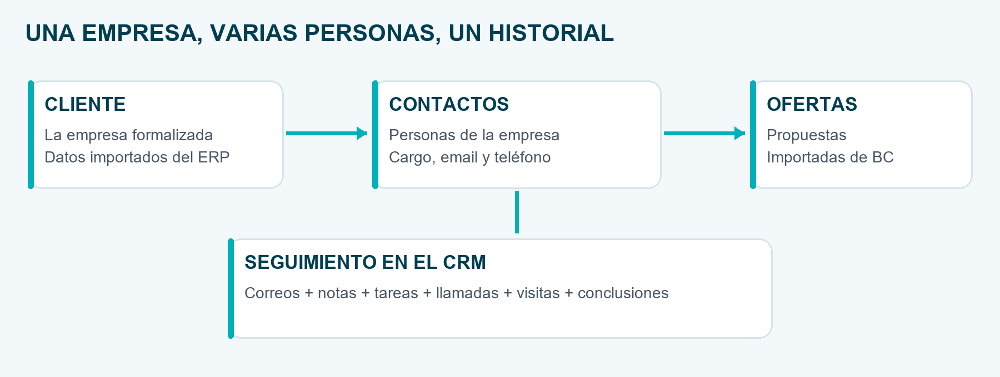

**Qué aporta Clientes:** una visión de tu cartera, sus ventas, su saldo y su relación comercial con dTS. **Qué aporta Contactos:** conocer al interlocutor y conservar el contexto de correos, actividades y ofertas.

**Regla para orientarte:** si buscas una empresa, entra en Clientes. Si buscas una persona, un correo o una reunión con ella, entra en Contactos.

Las altas de clientes y las ofertas se realizan en Business Central y se importan a la app. Crear una actividad no crea una oferta, y guardar un correo no significa enviarlo.

## 2. Entrar, moverse y entender los permisos

### Procedimiento: llegar a la vista correcta

1. Inicia sesión con tu usuario habitual de la app.
2. En el menú lateral, abre CRM.
3. Selecciona **Clientes** para empresas o **Contactos** para personas.
4. Si aparece el resumen de la jornada, ciérralo para continuar en la vista.
5. En un directorio, utiliza el buscador en lugar de recorrer toda la lista.

**Resultado esperado:** ves las cuentas y contactos incluidos en tu ámbito de acceso. Una lista reducida puede ser correcta: Ventas trabaja con los clientes de su código comercial y con los contactos de esas empresas. La regla de alcance global definida para Clientes y Contactos incluye Admin, Dirección, Tester y Producción; el permiso para entrar en cada vista se asigna por rol. La comprobación completa de Tester y Producción en la interfaz sigue pendiente, aunque el backend ya admite ese alcance.

### Por qué tu pantalla puede ser diferente

El administrador asigna permisos a los roles desde Gestión de Cuentas. Tener un rol no implica que todas las vistas estén habilitadas. Los módulos de prueba, como Prospección, pueden no aparecer. En pantallas estrechas, algunas etiquetas se sustituyen por iconos y puede ser necesario desplazar una tabla horizontalmente.

- Si falta una vista, pide al administrador que revise el permiso de tu rol.
- Si falta una empresa concreta, indica su código y comprueba el comercial asignado.
- Ver una actividad de otro usuario no da acceso a su buzón de Outlook: la apertura de mensajes utiliza la cuenta conectada de quien abre.

### Claro y oscuro

El botón de tema de la cabecera alterna la apariencia. Los procedimientos y datos son los mismos. Las capturas de este manual utilizan el modo oscuro que estaba activo durante la consulta; no es necesario cambiar de tema para seguirlas.

## 3. Tu primera sesión, en diez minutos

**Objetivo:** localizar una empresa, encontrar a su interlocutor y comprobar el seguimiento existente antes de hacer nada nuevo.

1. En **CRM > Clientes**, escribe parte del nombre de una empresa que conozcas.
2. Revisa su código, responsable y tipo de relación. No cambies la clasificación solo para probar el selector: se guarda al elegirla.
3. En **CRM > Contactos**, busca esa empresa o el nombre del interlocutor.
4. Pulsa el nombre de la persona para entrar en su ficha.
5. Abre **Información** para confirmar que es la persona correcta.
6. Abre **Timeline** y lee las últimas interacciones.
7. Abre **Eventos** para comprobar si ya hay una tarea pendiente.
8. Abre **Emails** para revisar la conversación registrada.
9. Consulta **Ofertas** si necesitas el contexto económico.
10. Vuelve al directorio con **Volver al Directorio de Contactos**.

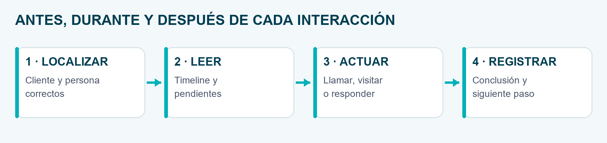

**Lo que aporta:** evita llamar sin contexto, duplicar tareas o redactar un correo que ya ha preparado otro compañero.

**Comprobación final:** sabes con quién estás hablando, qué se acordó la última vez y cuál es el siguiente paso. Si solo estabas consultando, no es necesario guardar nada.

**Ejercicio seguro:** realiza los pasos anteriores sin pulsar Guardar, Eliminar, Sincronizar ni Enviar. La consulta del histórico es suficiente para aprender a orientarte.

## 4. Clientes: reconocer la pantalla

La vista tiene dos áreas: **Directorio de Clientes** y **Matriz de Relación / Análisis YTD**. La primera responde «¿qué cuentas tengo?». La segunda responde «¿cómo se comporta mi cartera?».

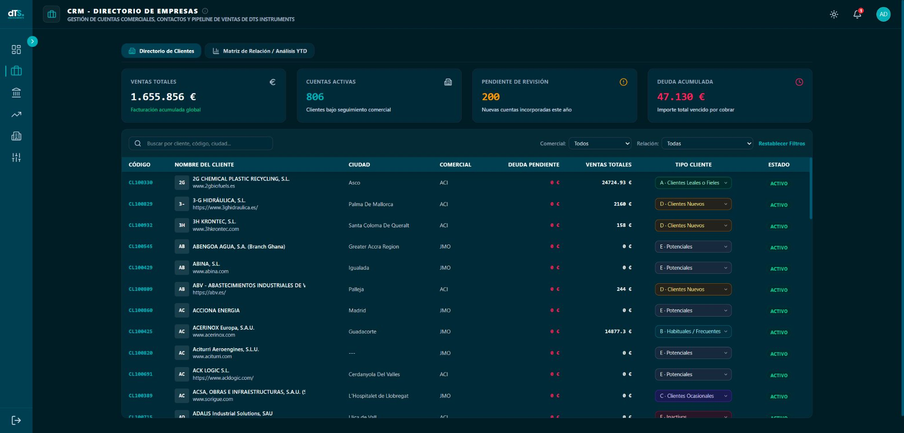

### Cómo leerla de arriba abajo

1. **Pestañas:** cambian entre directorio y análisis.
2. **Cuatro indicadores:** resumen de ventas, cuentas, nuevas incorporaciones y saldo.
3. **Buscador y filtros:** acotan el conjunto que estás consultando.
4. **Tabla:** muestra el detalle de las empresas.

Cada fila incluye código, nombre, ciudad, comercial, deuda pendiente, ventas totales, tipo de cliente y estado. Si hay web, aparece junto al nombre. Los guiones indican un dato no informado; no significan cero euros ni una incidencia.

**La tabla carga más cuentas al bajar.** No confundas las primeras filas visibles con el total de tu cartera. Mientras aparece «Cargando más clientes», deja que termine.

**Captura real:** los importes de la imagen son una fotografía de consulta, no objetivos ni cifras que deban coincidir con tu sesión. Amplía el PDF para leer el detalle de la pantalla.

## 5. Clientes: buscar, filtrar y volver a empezar

### Procedimiento: localizar una empresa

1. Abre **Directorio de Clientes**.
2. Escribe una parte significativa del nombre o su código.
3. Espera un instante después de escribir; la búsqueda no consulta con cada pulsación.
4. Si tienes selector de **Comercial**, elige el responsable que deseas analizar.
5. En **Relación**, selecciona una categoría si necesitas afinar la búsqueda.
6. Comprueba el código y el nombre antes de trabajar con la fila.

También puedes buscar por información geográfica y por código comercial. Si la búsqueda por una razón social larga no funciona, prueba una palabra distintiva o el código ERP.

### Procedimiento: localizar una cartera que requiere atención

1. Selecciona el comercial, si tu perfil lo permite.
2. Elige **F - Inactivos** para preparar una reactivación, o **E - Potenciales** para una acción de desarrollo.
3. Revisa las cuentas y anota qué persona debes contactar.
4. Continúa en Contactos para consultar su histórico y preparar una actividad.

**Restablecer Filtros** limpia la búsqueda y los filtros disponibles. En perfiles limitados a una cartera, no elimina la restricción de acceso al comercial propio.

### Si no encuentras nada

Antes de solicitar un alta, elimina filtros y vuelve a buscar. Comprueba que no estás buscando el nombre de una persona en el directorio de empresas. Si la empresa se acaba de crear en Business Central, espera la importación o consulta al responsable de la sincronización. No crees una segunda empresa para resolver una demora.

**Lo que aporta:** trabajar con un conjunto concreto y evitar conclusiones basadas en una cartera equivocada.

## 6. Clientes: interpretar los cuatro indicadores

| Indicador | Qué te está diciendo | Cómo utilizarlo |
| --- | --- | --- |
| Ventas Totales | Suma del dato de ventas de las cuentas que devuelve el filtro. | Dimensionar la cartera consultada. |
| Cuentas Activas | Número de cuentas del resultado. | Saber cuántas empresas estás analizando. |
| Pendiente de Revisión | Cuentas incorporadas desde el inicio del año actual. | Revisar altas recientes y preparar su seguimiento. |
| Deuda Acumulada | Suma del saldo pendiente que recibe la vista. | Priorizar la consulta financiera con Administración. |

**Dos etiquetas que pueden confundir:** «Cuentas Activas» es un contador del conjunto consultado; no sustituye a la columna Estado de cada empresa. «Pendiente de Revisión» identifica altas del año; no acredita por sí sola que alguien haya revisado o dejado de revisar la ficha.

### Ejemplo didáctico

Has filtrado una cartera de diez empresas. Si el indicador muestra 10 cuentas, significa que el filtro devuelve diez registros, aunque no estén todos cargados en pantalla. Si una fila dice Bloqueado, no concluyas que las otras nueve están al corriente de pago: bloqueo y saldo son datos distintos.

### Qué no debes comparar directamente

Las **Ventas Totales del directorio** y la **facturación YTD de la matriz** no son necesariamente la misma medida: tienen distinto origen y criterio temporal. Antes de interpretar una diferencia, revisa filtros, ejercicio y corte de fechas.

**Buena práctica:** cuando comuniques una cifra, acompáñala de la vista, el filtro y el período. Por ejemplo: «Matriz, mi cartera, 2026, corte YTD».

## 7. Clientes: clasificar la relación A-F

La clasificación describe la relación comercial, no el tamaño de la empresa ni la fase de una oferta. Es una valoración de gestión que debe seguir los criterios acordados por el equipo.

| Código | Nombre del directorio | Interpretación y acción orientativa |
| --- | --- | --- |
| A | Clientes Leales o Fieles | Relación sólida y recomendación. Cuidar continuidad. En la matriz también se denomina Cautivos. |
| B | Habituales / Frecuentes | Compra recurrente. Mantener cercanía y servicio. |
| C | Clientes Ocasionales | Compra sin ritmo fijo. Identificar próximos proyectos. |
| D | Clientes Nuevos | Primera compra reciente. Acompañar el arranque. |
| E | Potenciales | Categoría comercial de desarrollo. Revisar interés y encaje. |
| F | Inactivos | Relación anterior sin continuidad reciente. Investigar y reactivar. |
| Sin clasificar | Sin categoría asignada | Revisar con el responsable antes de asignar. |

### Procedimiento: cambiar una categoría

1. Localiza la empresa y confirma su código.
2. Abre el selector **Tipo Cliente** de su fila.
3. Elige la categoría acordada.
4. Espera la actualización y comprueba que la etiqueta queda seleccionada.
5. Si tienes un filtro de relación activo, ten en cuenta que la empresa puede salir del resultado al pasar a otra categoría.

**El cambio se guarda al seleccionar.** No hay un botón final que permita acumular cambios pendientes.

La clasificación no mueve ofertas, no crea actividades y no convierte automáticamente un prospecto en cliente. Tampoco es una clasificación que deba deducirse únicamente de un porcentaje o importe.

## 8. Clientes: leer la matriz de relación

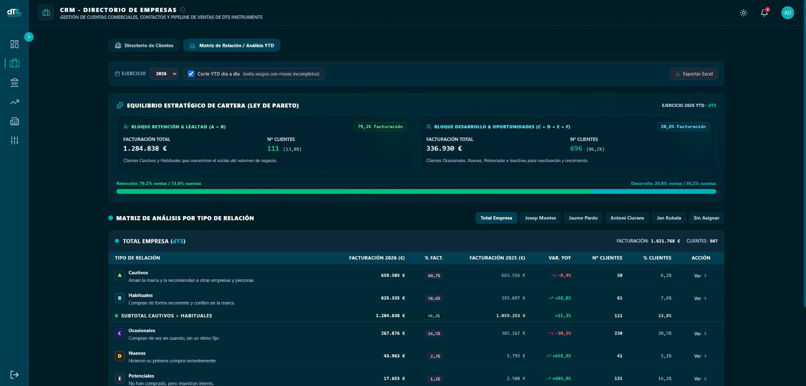

### Procedimiento: comparar una cartera de forma homogénea

1. Abre **Matriz de Relación / Análisis YTD**.
2. Selecciona el ejercicio.
3. Mantén marcado **Corte YTD día a día** para comparar el acumulado con el mismo corte del año anterior.
4. Selecciona **Total Empresa** o la pestaña del comercial que tengas autorizada.
5. Lee la facturación actual, la anterior y la variación; después revisa cuántas cuentas hay detrás.

**YTD** significa «desde el inicio del año hasta el corte correspondiente». Desmarcar la casilla permite analizar el ejercicio completo. No compares un año completo con otro incompleto como si fueran períodos iguales.

La banda de equilibrio resume **A+B**, retención y lealtad, frente al bloque de desarrollo. Es una ayuda para observar concentración: una cartera con muchas cuentas no necesariamente aporta la mayor parte de las ventas.

La distribución mostrada es un resultado de los datos; la referencia a Pareto no obliga a que siempre se cumpla un reparto exacto 80/20.

## 9. Clientes: actuar desde la matriz y exportar

### Qué significa cada columna

| Columna | Cómo interpretarla |
| --- | --- |
| Facturación del año | Ventas de la categoría en el período seleccionado. |
| % Fact. | Parte de las ventas del bloque que aporta la categoría. |
| Facturación anterior | Base comparable del ejercicio anterior. |
| Var. YoY | Cambio porcentual respecto al año anterior; positivo es aumento y negativo descenso. |
| Nº Clientes | Cuentas asignadas a la categoría del bloque. |
| % Clientes | Peso de esas cuentas sobre el total. |
| Ver | Lleva del dato agregado a la consulta del directorio. |

**Ejemplo didáctico:** pasar de 100.000 a 120.000 euros es crecer un 20%. Tener el 20% de las cuentas no significa aportar el 20% de las ventas. Si el año anterior no tenía ventas, no interpretes la variación como un crecimiento porcentual ordinario.

### Procedimiento: pasar de un dato a las empresas

1. Selecciona una categoría A-F y pulsa **Ver** o su fila.
2. Comprueba que vuelves al directorio.
3. Revisa el filtro de relación y, si corresponde, el comercial aplicado.
4. Busca al contacto de la empresa para preparar la acción comercial.

### Procedimiento: descargar el análisis

1. Comprueba año, corte YTD y ámbito autorizado.
2. Espera a que termine el cálculo.
3. Pulsa **Exportar Excel**.
4. Abre el archivo descargado y comprueba ejercicio y comerciales incluidos. La exportación puede contener varios bloques autorizados, no solo la pestaña visible.

El Excel es una copia para analizar: editarlo no cambia el CRM. Si acabas de reclasificar una cuenta y la matriz parece conservar el resultado anterior, vuelve a cargar el análisis antes de exportar.

## 10. Clientes: la ficha lateral, cuando está disponible

En las cuentas con acceso habilitado a la ficha, el nombre del cliente se puede pulsar para abrir **Ficha del Cliente**. En otros despliegues puede aparecer como texto: no es un fallo de tu ratón ni hay que forzar la apertura.

### Procedimiento de consulta

1. Localiza la cuenta y pulsa su nombre si está habilitado.
2. Confirma razón social, código y vendedor.
3. Revisa clasificación, información de contacto y localización.
4. Consulta las **Personas de Contacto** y su cargo.
5. Revisa el resumen financiero disponible.
6. Cierra el panel para volver al mismo directorio.

**Acciones disponibles según los datos:** Llamar, WhatsApp, enlaces de email, Ver en Google Maps y perfiles de LinkedIn. Abrir un enlace de llamada o WhatsApp no registra automáticamente una actividad comercial. Una consulta en Maps tampoco modifica la dirección del cliente.

El enlace de correo de esta ficha puede utilizar el programa de correo predeterminado del equipo. Para el flujo integrado de redacción y registro, utiliza la ficha de la persona en Contactos.

Si aparece **Seguimiento de prospección**, muestra actividades de prospectos actualmente asociados a esa cuenta. Deshacer una asociación incorrecta retira ese seguimiento de la cuenta equivocada y lo conserva en el prospecto.

### Datos maestros

La ficha no sustituye Business Central. Para corregir datos maestros de empresa, solicita la corrección en el ERP. Los controles de clasificación o enriquecimiento que la app muestra son acciones específicas; no habilitan una edición general del cliente.

## 11. Contactos: localizar a la persona correcta

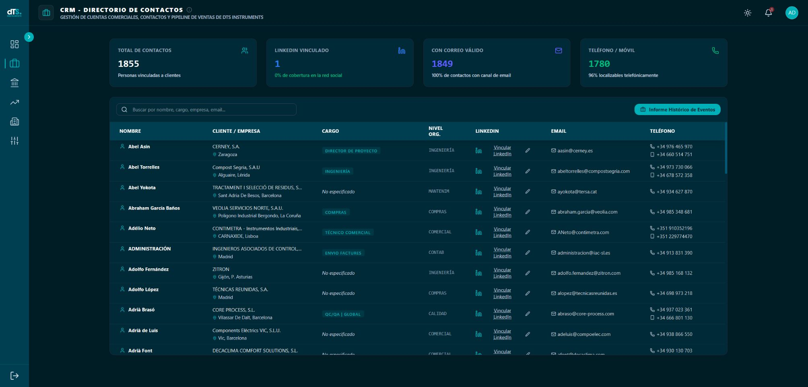

### Procedimiento

1. Abre **CRM > Contactos**.
2. Escribe nombre, cargo, empresa o email en el buscador.
3. Espera un instante y comprueba los resultados.
4. Revisa la columna **Cliente / Empresa** para distinguir personas con nombres parecidos.
5. Pulsa el nombre de la persona para entrar en su ficha.

También se admite búsqueda por información de teléfono, nivel organizativo y ubicación disponible. Al bajar se muestran más contactos en bloques; que una persona no aparezca entre las primeras filas no significa que no exista.

**Columnas:** Nombre; Cliente / Empresa; Cargo; Nivel Org.; LinkedIn; Email; Teléfono. El teléfono y móvil pueden aparecer como dos líneas distintas.

Los indicadores **Total de Contactos**, **LinkedIn Vinculado**, **Con Correo Válido** y **Teléfono / Móvil** describen el conjunto cargado del directorio autorizado. La búsqueda de texto no recalcula esas tarjetas sobre cada resultado filtrado.

**«Con Correo Válido» indica que hay un email informado.** No acredita que se haya comprobado su entrega. Los porcentajes se redondean; un 100% visible no siempre significa que no falte ningún contacto por completar.

### Buscar sin tildes ni diferencias de mayúsculas

Escribe en el buscador y espera un instante. «jose» encuentra «José»; «garcia», «García». Mayúsculas y minúsculas dan las mismas coincidencias. Borra el texto para recuperar la lista.

La comparación se aplica a los campos buscables de esta tabla. Conserva la escritura original y busca solo en tu cartera autorizada; no amplía los permisos ni cambia otros selectores.

## 12. Contactos: acciones rápidas y LinkedIn

### Procedimiento: abrir un correo nuevo desde el directorio

1. Confirma que has encontrado la persona correcta.
2. Pulsa su email.
3. Se solicita la redacción en el cliente de Outlook que tengas preferido.
4. Comprueba destinatario, asunto y contenido antes de enviar.

Este enlace sirve para comenzar una comunicación. Si necesitas un correo con plantilla y seguimiento preparado desde el CRM, abre la ficha y utiliza **Redactar Correo en Outlook**.

### Procedimiento: añadir o corregir LinkedIn

1. En la fila, pulsa **Vincular LinkedIn**, **Añadir LinkedIn** o el lápiz, según la pantalla.
2. Pega la dirección del perfil de la persona correcta.
3. Pulsa la marca de guardar.
4. Comprueba que aparece el enlace y que corresponde a esa persona.
5. Para abandonar la edición sin guardar, pulsa la X.

El mismo enriquecimiento está accesible desde la cabecera de la ficha del contacto y, cuando se muestra, desde sus tarjetas en la ficha de cliente.

**Qué aporta:** encontrar rápidamente el contexto profesional del interlocutor. No importa automáticamente su perfil ni incorpora sus publicaciones al CRM.

Los números de teléfono utilizan enlaces de llamada. Su funcionamiento depende de que el ordenador o móvil tenga una aplicación asociada. Abrir la llamada no crea un registro de «Llamada»; añade esa actividad después si necesitas conservar el resultado.

## 13. La ficha: cinco pestañas, cinco preguntas

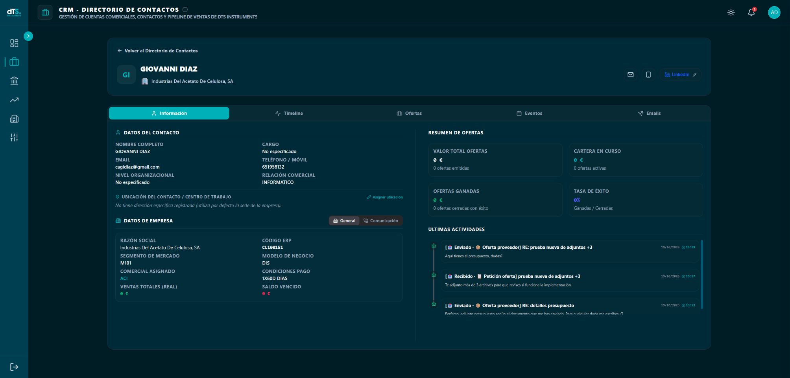

| Pestaña | Pregunta que resuelve | Cuándo usarla |
| --- | --- | --- |
| Información | ¿Quién es y en qué empresa trabaja? | Antes de llamar o preparar una reunión. |
| Timeline | ¿Qué ha ocurrido, por orden temporal? | Para recuperar el contexto de toda la relación. |
| Ofertas | ¿Qué propuestas tiene asociadas? | Para revisar importes y seguimiento comercial. |
| Eventos | ¿Qué actividades tengo pendientes o realizadas? | Para planificar y cerrar el trabajo. |
| Emails | ¿Qué mensajes se han registrado? | Para filtrar, abrir y responder correos. |

En la cabecera tienes el nombre, la empresa y los accesos disponibles a email, teléfono y LinkedIn. **Volver al Directorio de Contactos** te saca de la ficha.

En ventanas pequeñas puede mostrarse solo el icono de cada pestaña. Amplía la ventana o pasa el puntero por los controles si necesitas reconocerlos. La zona de contenido tiene su propio desplazamiento: baja dentro de ella para ver tarjetas que quedan más abajo.

**No confundas las dos fichas:** la ficha de cliente resume una empresa; la de contacto organiza el seguimiento de una persona concreta.

## 14. Información: datos, ubicación y resumen de ofertas

La pestaña **Información** reúne los datos del contacto, la empresa, un resumen de ofertas y las últimas actividades. En **Datos de Empresa** hay dos subpestañas: **General** y **Comunicación**.

### Procedimiento: preparar una visita

1. Confirma nombre, cargo, nivel organizativo y relación comercial de la persona.
2. Consulta la ubicación específica del contacto. Puede trabajar en un centro distinto a la sede.
3. Si no hay ubicación específica, la pantalla informa de que utiliza por defecto la sede de la empresa.
4. Abre **Comunicación** para ver email, teléfono y dirección de empresa.
5. Utiliza **Ver en Maps** cuando esté disponible.

### Procedimiento: asignar o editar la ubicación del contacto

1. Pulsa **Asignar ubicación** o **Editar ubicación**.
2. Revisa dirección, complemento de dirección, código postal, ciudad, provincia y territorio.
3. Guarda con el botón del formulario o cancela para salir sin cambios.
4. Comprueba la dirección visible al volver a Información.

Este control edita la ubicación disponible en la ficha del contacto; no es el formulario general de dirección de la empresa. Si un dato importado vuelve a su valor anterior tras una sincronización, informa al responsable del ERP para acordar dónde mantenerlo.

**Resumen de ofertas:** valor total, cartera en curso, ganadas y tasa de éxito. La tasa se expresa como ganadas entre cerradas; no es el porcentaje de probabilidad de una oferta concreta. Una ficha sin ofertas puede tener muchas actividades y correos: son conjuntos diferentes.

Las tres últimas actividades sirven de acceso rápido. Para consultar el historial completo, utiliza Timeline.

## 15. Timeline: recuperar toda la conversación comercial

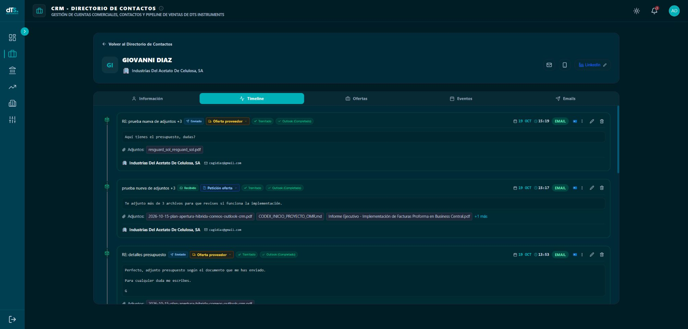

### Procedimiento: preparar una llamada con contexto

1. Abre la ficha y entra en **Timeline**.
2. Lee las entradas más recientes y su fecha y hora.
3. Distingue el tipo: email, nota, tarea, visita, llamada u otra actividad.
4. Revisa los acuerdos y conclusiones ya registrados.
5. Si una tarjeta tiene texto recortado, pulsa **Ver más**.
6. Utiliza el lápiz para revisar o corregir los detalles del registro, si tienes permiso.

**Qué aporta:** evita saltar de una pestaña a otra para entender la secuencia de la relación. Emails y Eventos muestran subconjuntos del mismo seguimiento; Timeline los reúne.

Las tarjetas de email conservan sus acciones de Outlook, tipología y nombres de adjuntos. Los colores y estados de las actividades ayudan a distinguir realizado y pendiente, pero lee siempre la etiqueta: el color por sí solo no explica si faltan conclusiones.

**Importante:** un email «Tramitado» significa que su gestión en el CRM figura completada. No es una confirmación de lectura del destinatario ni una garantía de entrega del correo.

## 16. Eventos: planificar y filtrar el trabajo

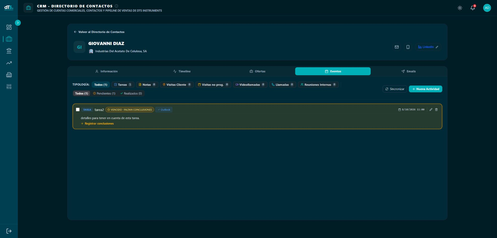

La pestaña **Eventos** permite consultar y gestionar las actividades del contacto. Combina filtros por **tipología** y **estado**.

### Procedimiento: encontrar lo que queda por hacer

1. Abre **Eventos**.
2. Elige **Todos** o una tipología: Tareas, Notas, Visitas Cliente, Visitas no programadas, Videollamadas, Llamadas o Reuniones Internas.
3. Selecciona **Pendientes** para reducir el resultado.
4. Lee fecha, hora, descripción y avisos de conclusiones.
5. Para recuperar todas las actividades, restablece tanto el tipo como el estado a **Todos**.

**Una lista vacía puede deberse al filtro.** No crees una actividad nueva hasta comprobar que la existente no está en Realizados o en otra tipología.

**Sincronizar** solicita la revisión del estado con Outlook cuando hay una cuenta conectada. Espera a que deje de indicar «Sincronizando…». No sirve para importar clientes u ofertas desde Business Central.

La pantalla puede actualizarse al volver a la ventana o periódicamente mientras trabajas con eventos. Esto no equivale a una confirmación instantánea de todos los cambios del calendario: revisa el resultado antes de repetir una operación.

## 17. Nueva actividad: elegir el tipo adecuado

| Tipo | Utilidad | Consideración práctica |
| --- | --- | --- |
| Tarea | Recordar una acción y su fecha. | Ejemplo: revisar una especificación. |
| Nota Interna | Conservar información comercial. | Describe el contenido; no requiere fecha de cita. |
| Visita a Cliente | Planificar una visita presencial. | Revisa la ubicación antes de guardar. |
| Videollamada Teams / Online | Preparar una reunión remota. | Con conexión Microsoft 365 puede generar convocatoria y enlace; comprueba destinatarios y calendario. |
| Llamada Telefónica | Planificar o registrar una llamada. | Llamar y registrar el resultado son acciones distintas. |
| Visita no programada | Registrar una visita espontánea. | Se registra en CRM y, con conexión, en tu calendario sin enviar correo al contacto. |
| Reunión Interna | Opción reservada para una ampliación. | El formulario actual avisa de que se configurará próximamente. No permite completar el alta normal. |

### Procedimiento general

1. Pulsa **Nueva Actividad**.
2. Elige el tipo; no utilices Reunión Interna para intentar crear una visita de cliente.
3. Escribe un título concreto: «Llamar para confirmar plazo de entrega» es mejor que «Seguimiento».
4. Completa fecha y hora cuando se soliciten.
5. Añade ubicación si corresponde y los detalles necesarios.
6. Revisa el indicador **Conectado a Exchange** o **Modo Local**.
7. Pulsa **Guardar y Sincronizar** y comprueba que aparece la tarjeta.

**Modo Local** significa que no debes dar por creada una cita en Outlook. Comprueba la conexión antes de depender del calendario para avisos o convocatorias.

### Visita a Cliente y Videollamada: preparar la convocatoria

Al crear cualquiera de estas dos actividades en una pantalla amplia, el formulario se reparte en dos columnas. En una pantalla estrecha se apila para facilitar la lectura.

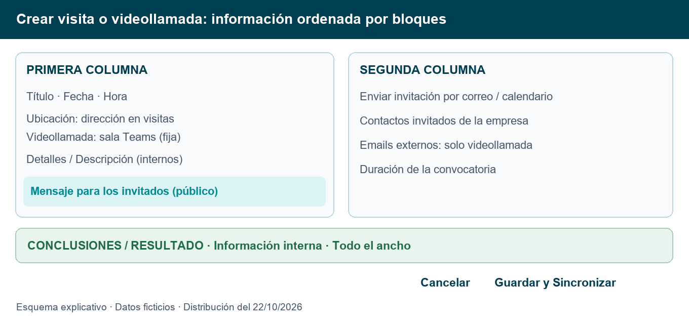

| Zona | Qué completar | Quién recibe esa información |
| --- | --- | --- |
| Primera columna | Título, fecha, hora, ubicación, detalles internos y Mensaje para los invitados. | El mensaje se incluye en la convocatoria; los detalles internos permanecen en el CRM. |
| Segunda columna | Enviar invitación por correo / calendario, contactos invitados y duración. En videollamada, también emails externos. | Los destinatarios seleccionados reciben la convocatoria. |
| Pie del contenido, a todo el ancho | Conclusiones / Resultado. | Es información interna del CRM. |

El mensaje de invitados se muestra cuando el envío está activado. Las conclusiones se sitúan debajo de ambas columnas; no son un botón de envío. Los botones de guardar y cancelar permanecen en el pie de acciones. Al editar una actividad puede mantenerse la distribución anterior del mensaje y las conclusiones: el cambio de distribución del 22/10 corresponde al formulario de creación.

**Ubicación de la videollamada:** siempre muestra **sala Teams**, en modo de solo lectura. No introduzcas la dirección de la empresa. El CRM impone este valor también al guardar y al sincronizar con Outlook, por lo que no puede sustituirse por una dirección al editarla. El enlace de acceso a Teams lo genera Microsoft 365; «sala Teams» es la etiqueta de ubicación y no sustituye ese enlace.

## 18. Actividades: ejemplo completo de ejecución

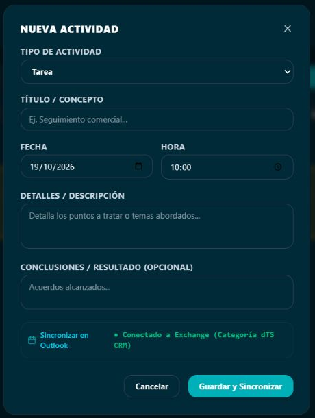

### Ejemplo: registrar una visita no programada

1. Abre la ficha de la persona visitada y entra en Eventos.
2. Pulsa **Nueva Actividad** y elige **Visita no programada**.
3. Indica un concepto reconocible, como «Visita de seguimiento de instalación».
4. Introduce la fecha y hora reales de la visita.
5. Revisa la ubicación. Si aparece **Usar dirección de la empresa**, comprueba que sea el centro correcto antes de utilizarla.
6. En Detalles, describe lo tratado; en Conclusiones, registra acuerdos y siguiente paso.
7. Guarda una sola vez y revisa la tarjeta creada.

**Lo que aporta:** conserva una visita que no estaba agendada y permite revisarla en el histórico y los informes. No se envía una invitación al cliente por este tipo de actividad.

En tareas y notas, no confíes en el campo de conclusiones del alta para completar su gestión: revisa la tarjeta y utiliza el procedimiento de cierre o edición posterior. La presencia de un campo en el formulario no convierte una tarea nueva automáticamente en realizada.

### Ejemplo: concertar una visita con el cliente

1. Abre la ficha del contacto correcto y entra en Eventos → Nueva Actividad.
2. Elige **Visita a Cliente** y completa título, fecha, hora y lugar de la visita.
3. Mantén marcada **Enviar invitación por correo / calendario**. El contacto de la ficha aparece seleccionado si tiene email válido.
4. En la segunda columna, revisa **Contactos invitados de la empresa**. Añade las personas necesarias; los contactos sin email válido no se pueden seleccionar.
5. En la primera columna, redacta **Mensaje para los invitados**, por ejemplo: «Confirmamos la visita a su sede para revisar la instalación».
6. Elige la duración. Comprueba que Microsoft 365 está conectado y el calendario habilitado.
7. Guarda una vez. Comprueba el evento en Outlook y que el destinatario recibe la invitación.
8. El destinatario podrá aceptar, rechazar o proponer otra hora según su proveedor de calendario. Recibir una invitación no significa haberla aceptado.

La recepción real de una invitación de visita ha sido confirmada por el usuario. Guardar el registro CRM no garantiza por sí solo el envío si falla la conexión a Outlook.

### Ejemplo: organizar una videollamada con invitados externos

1. Elige **Videollamada Teams / Online** e indica título, fecha y hora.
2. Comprueba la ubicación fija **sala Teams**.
3. Selecciona los contactos de la empresa en la segunda columna.
4. En **Otros invitados (emails externos)**, escribe la dirección y pulsa **Añadir** o Enter. Puedes separar direcciones con coma, punto y coma o espacios. Revisa las etiquetas de destinatarios antes de guardar.
5. Escribe el mensaje público en la primera columna y selecciona duración.
6. Guarda y comprueba el enlace Teams y los destinatarios en la convocatoria de Outlook. Los invitados pueden ver a los demás participantes; añadir un email externo no crea un contacto CRM.

**Privacidad:** Detalles / Descripción y Conclusiones / Resultado son internos. Solo el mensaje público se incluye en el cuerpo de la convocatoria. No escribas conclusiones en el mensaje a invitados si deseas mantenerlas privadas.

## 19. Completar, reabrir, editar y eliminar actividades

### Procedimiento: cerrar correctamente una actividad

1. Localiza la tarjeta en Eventos o Timeline.
2. Pulsa la casilla de realizado o **Registrar conclusiones** cuando aparezca.
3. Describe lo ocurrido, el resultado y el siguiente paso con su responsable.
4. Guarda y comprueba el estado de la tarjeta.
5. Cuando tenga sincronización con Outlook, revisa la categoría de completado en el calendario.

**Conclusión útil:** «El cliente confirma que necesita entrega en noviembre. Enviar alternativa el jueves; responsable: comercial». Es más útil que «Hecho».

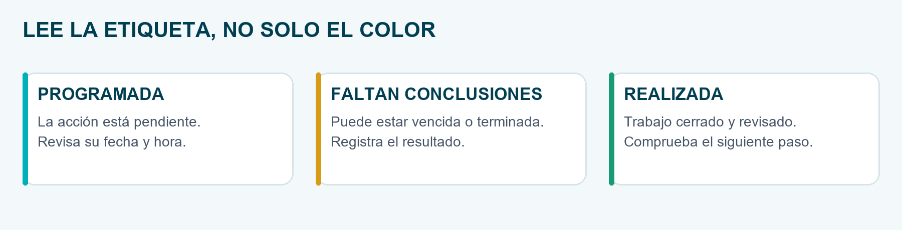

### Corregir o reabrir

Utiliza el lápiz para modificar título, detalles, fecha, hora, ubicación y conclusiones según el registro. Para reabrir, utiliza la casilla de pendiente y comprueba también las conclusiones: una actividad con conclusiones puede seguir mostrándose como terminada. Si quieres dejarla pendiente, revisa ambos datos.

### Eliminar: revisar antes de confirmar

La papelera de una actividad de calendario puede implicar su retirada del calendario sincronizado. No la utilices como una forma de marcar «realizado». Lee el mensaje de confirmación.

**Excepción importante:** eliminar un email del CRM conserva el correo original en Outlook. Este comportamiento no debe extrapolarse a las citas de calendario.

## 20. Informe histórico: preparar PDF y Excel

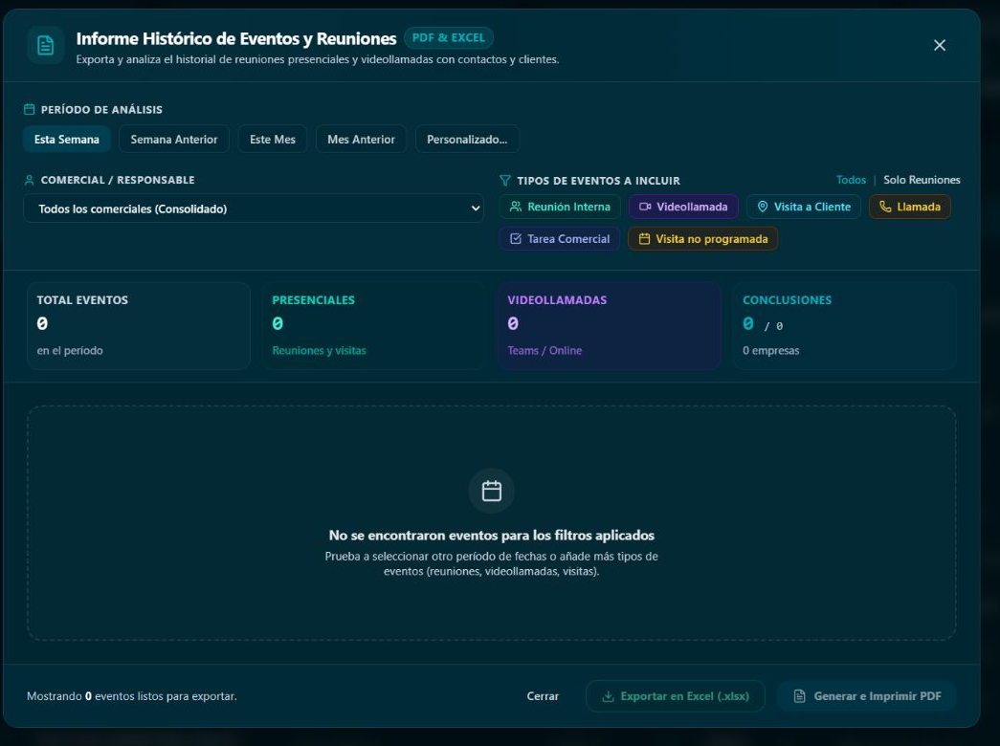

### Procedimiento

1. Desde el directorio de Contactos, pulsa **Informe Histórico de Eventos**.
2. Elige Esta Semana, Semana Anterior, Este Mes, Mes Anterior o Personalizado.
3. Si eliges Personalizado, introduce fecha inicial y final.
4. Selecciona el responsable si tienes permiso. Un comercial consulta sus eventos; Admin y Dirección pueden seleccionar un responsable o consolidar el equipo.
5. Activa los tipos que necesitas. **Solo Reuniones** limita a visitas, reuniones internas y videollamadas; no es una selección automática de todas las interacciones.
6. Espera a que termine la consulta y revisa las métricas y registros.
7. Pulsa **Exportar en Excel (.xlsx)** o **Generar e Imprimir PDF**.

Para guardar el PDF, utiliza **Guardar como PDF** en el diálogo de impresión del navegador si no se descarga directamente. Revisa la vista previa antes de confirmar.

Los botones pueden estar deshabilitados si no hay registros. Amplía el período, revisa los tipos y el responsable; no significa necesariamente que el informe esté averiado.

**Lo que aporta:** preparar una reunión de seguimiento, justificar la actividad comercial y detectar registros sin conclusiones. El informe no sustituye la bandeja de correos: la selección inicial está orientada a eventos y tareas.

## 21. Emails: leer una tarjeta y sus adjuntos

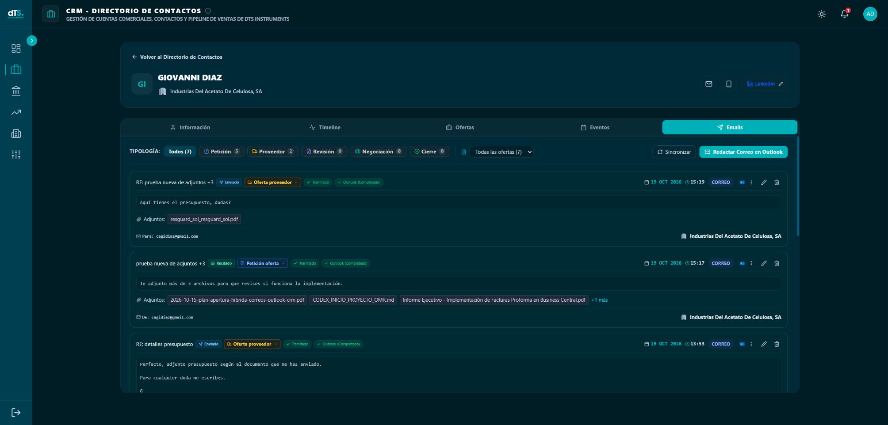

Una tarjeta puede mostrar asunto, dirección Enviado o Recibido, tipología, estado de gestión, fecha y hora, texto, nombres de adjuntos, empresa y oferta vinculada cuando exista.

### Procedimiento de lectura

1. Confirma asunto, fecha y si es recibido o enviado.
2. Lee el cuerpo; pulsa **Ver más** si está recortado.
3. Revisa la tipología y la oferta antes de interpretarlo como parte de una negociación.
4. Consulta los nombres de adjuntos; con más de tres, pulsa **+N más**.
5. Para abrir o descargar los archivos, abre el correo original en Outlook.

**Los nombres de adjuntos son informativos.** El CRM no almacena en esta tarjeta una copia descargable de esos archivos. Las imágenes incrustadas de firma se excluyen; por eso el recuento puede no coincidir con todos los elementos gráficos que Outlook considera adjuntos.

Un correo antiguo puede no tener nombres de adjuntos guardados. La ausencia de sección no prueba que el original no tuviera archivos. También pueden aparecer estados de información parcial, no disponible o pendiente tras el envío.

## 22. Emails: filtrar por oferta y por tipología

La barra combina dos preguntas distintas: «¿de qué oferta?» y «¿qué clase de correo?». Ambos filtros se aplican a la lista.

| Tipología completa | Etiqueta breve | Cuándo utilizarla |
| --- | --- | --- |
| Petición oferta | Petición | Solicitud o requerimientos del cliente. |
| Oferta proveedor | Proveedor | Propuesta o información económica del proveedor. |
| Revisión oferta | Revisión | Cambios técnicos o económicos de la propuesta. |
| Negociación | Negociación | Discusión de condiciones o acuerdos. |
| Cierre/Aceptación | Cierre | Confirmación o aceptación documentada. |

### Procedimiento: ver las negociaciones de una oferta

1. En Emails, abre el selector de ofertas.
2. Elige su número. Si existen vínculos, también puedes elegir **Solo con oferta vinculada** o **Sin oferta vinculada (Generales)**.
3. Pulsa la tipología **Negociación**.
4. Comprueba el conjunto de tarjetas y los contadores. Los contadores por tipología se calculan sobre la oferta filtrada, antes de limitar a una tipología.
5. Para volver a toda la conversación registrada, elige **Todas las ofertas** y **Todos**.

### Procedimiento: corregir una tipología

Pulsa la etiqueta de categoría de la tarjeta, elige la correcta y espera a que se guarde. También está disponible en Timeline. Es una clasificación del registro del CRM; no mueve el email a una carpeta de Outlook.

**Cierre/Aceptación no es una etiqueta neutra:** en el seguimiento anterior, un correo de cierre vinculado a una oferta puede actualizarla a Ganada. En el seguimiento nuevo gestionado desde la app, el cierre exige su procedimiento y motivo. Utiliza la categoría solo cuando refleje el contenido real del mensaje.

## 23. Registrar un correo desde el complemento de Outlook

**Objetivo:** que el mensaje aparezca en el seguimiento correcto. No todos los correos de tu buzón se incorporan al CRM por abrir la ficha de un contacto.

### Procedimiento

1. En Outlook Classic o Web, abre el mensaje que deseas registrar, recibido o enviado.
2. Abre el complemento **dTS Instruments CRM** desde las aplicaciones o complementos de Outlook. Su ubicación puede variar según la versión de Outlook.
3. Inicia sesión en el CRM dentro del complemento si lo solicita.
4. Comprueba la empresa detectada. Si no es correcta, utiliza la selección manual.
5. Selecciona el contacto concreto de esa empresa cuando necesites verlo en su ficha. Un registro a nivel de empresa sin contacto no es lo mismo que un registro vinculado a la persona.
6. Elige la tipología adecuada.
7. Vincula la oferta si procede; comprueba su número.
8. Pulsa **Guardar Correo en dTS CRM** y espera la confirmación.
9. Vuelve a la ficha del contacto y comprueba Emails o Timeline. Revisa filtros si no aparece.

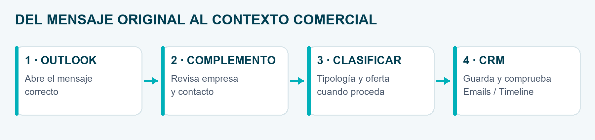

**Lo que aporta:** vincula el mensaje con su contexto comercial y guarda una referencia para volver al original. No es necesario renombrar carpetas ni conservar el correo en Bandeja de entrada.

Se pueden registrar nombres de adjuntos en mensajes nuevos. No se hace una recuperación automática de todos los correos históricos al conectar Microsoft 365 o vincular el equipo.

## 24. Abrir un correo en Classic o Web

### Procedimiento habitual

1. En Emails o Timeline, localiza la tarjeta correcta.
2. Pulsa el icono de Outlook. Se utiliza tu preferencia de Ajustes Generales.
3. Si aparece **Correo listo para abrir**, pulsa el botón de apertura del aviso; el navegador puede requerir ese segundo gesto.
4. Si hay varias copias, selecciona la carpeta y fecha correspondientes.
5. Si se solicita equipo, elige el ordenador Windows desde el que estás trabajando.
6. Comprueba el mensaje abierto antes de responder.

**Classic necesita instalación y vinculación del equipo. Web necesita una sesión Microsoft del buzón correspondiente.** No basta con haber descargado el ZIP.

El flujo comprueba el mensaje concreto. Moverlo entre carpetas del mismo buzón está contemplado. No se promete el mismo comportamiento para archivos PST, archivo en línea u otros buzones: consulta a soporte si se ha trasladado allí.

### Avisos que no desplazan la pantalla

En la versión actualizada, los avisos aparecen flotantes en la parte inferior y se cierran a los **10 segundos**. La X permite cerrarlos antes. Cerrar el aviso no cancela una apertura ya solicitada y su resultado puede mostrar otro aviso.

Si indica que la apertura no está confirmada, mira Classic antes de repetir el clic. La app no declara éxito solo porque el navegador haya perdido el foco.

### Forzar otro destino

Abre los tres puntos y elige **Abrir en Outlook Classic** o **Abrir en Outlook Web (M365)**. Esta elección puntual no cambia la preferencia general del navegador.

## 25. Responder, buscar conversación y eliminar del CRM

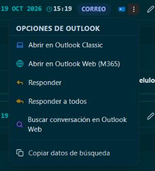

### Responder o responder a todos

1. Abre los tres puntos de la tarjeta.
2. Selecciona **Responder** o **Responder a todos**.
3. El CRM prepara la respuesta nativa sobre el mensaje verificado en tu cliente preferido.
4. Revisa los destinatarios reales que propone Outlook, especialmente en Responder a todos.
5. Redacta, adjunta archivos si procede y pulsa Enviar en Outlook.

Preparar una respuesta **no la envía automáticamente**. Los destinatarios proceden del mensaje original; no se sustituyen simplemente por el email actual de la ficha del contacto.

### Buscar o copiar

**Buscar conversación en Outlook Web** abre una búsqueda para consultar el hilo. Puede mostrar varios mensajes; no es la apertura exacta del icono de Outlook. **Copiar datos de búsqueda** copia una consulta para pegarla en Outlook cuando necesites buscar manualmente.

### Eliminar del CRM

Pulsa la papelera y lee la confirmación. Al aceptar, se elimina el registro y sus detalles guardados en la app; **el original permanece en Outlook**. No es una forma de archivar la conversación ni de borrarla del buzón. Si solo necesitas corregir tipología, oferta o notas, utiliza la edición.

## 26. Redactar un correo con plantillas

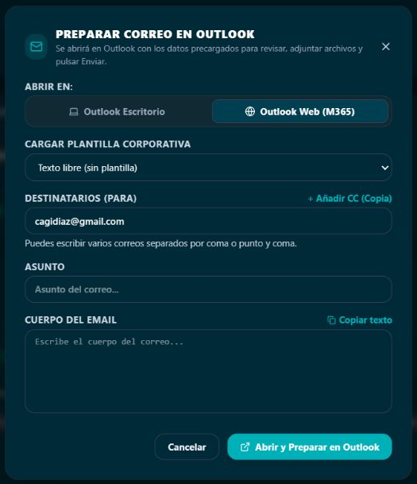

### Procedimiento

1. En Emails, pulsa **Redactar Correo en Outlook**.
2. Elige **Outlook Escritorio** o **Outlook Web (M365)**.
3. Selecciona Texto libre, Presentación comercial dTS, Seguimiento de oferta pendiente o Agradecimiento por su tiempo.
4. Revisa Para; admite varios emails separados por coma o punto y coma.
5. Añade CC si necesitas copia y revisa cada destinatario.
6. Revisa asunto y cuerpo. Personaliza la plantilla: no des por hecho que todos sus textos encajan con el caso.
7. Pulsa **Abrir y Preparar en Outlook**.
8. En Outlook, añade los archivos que menciones, revisa el resultado y pulsa Enviar.

**Una plantilla que dice «Adjunto…» no adjunta ningún archivo.** Debes incorporarlo en Outlook. **Copiar texto** copia el contenido; no envía ni registra un envío.

Después de preparar el mensaje puede existir un borrador pendiente. El seguimiento debe conciliarse con el enviado: si aparece un aviso de envío sin confirmar, comprueba Elementos enviados antes de volver a mandarlo.

## 27. Conectar Microsoft 365 y preparar tu equipo

### Primera configuración

1. Abre **Ajustes Generales** y pulsa **Conectar con Microsoft 365**.
2. Inicia sesión con tu buzón corporativo y completa el consentimiento que corresponda.
3. Al regresar a la app, comprueba qué cuenta figura conectada.
4. Elige Classic o Web como cliente preferido en ese navegador.
5. Si vas a utilizar Classic, descarga el ZIP publicado en Ajustes y extráelo completo.
6. Ejecuta **Instalar_Outlook_dTS.bat** con tu usuario habitual de Windows, conservando el ejecutable en la misma carpeta.
7. Sigue el código de vinculación: abre el CRM, confirma el código y vuelve al componente para comprobar la vinculación.
8. Abre un correo desde una tarjeta del CRM para probar el recorrido completo.

No confundas instalar, conectar el buzón y vincular el ordenador: son tres preparaciones distintas. Si falta alguna, puede funcionar Web pero no Classic.

### Cambiar de Classic a Web

Selecciona Web en Ajustes. La preferencia se guarda en ese navegador. No exige borrar registros ni desinstalar Classic. En otro navegador o equipo puede ser necesario seleccionar de nuevo la preferencia.

### Botón de prueba sin borrador

La entrega preparada el 19/10 abre la bandeja de entrada de Web y la ventana principal de Classic sin crear mensajes. Classic requiere componente 1.1.1 o posterior. **Esta prueba no acredita que un correo concreto se localice correctamente:** esa comprobación se hace desde su tarjeta.

El usuario ha aprobado la prueba sin borradores, la apertura en Classic abierto y cerrado, las vinculaciones, los permisos por rol y la prueba con un segundo usuario. La instrumentación de tiempos sirve para diagnóstico: estas comprobaciones no establecen un tiempo de apertura garantizado.

## 28. Ofertas dentro de la ficha de contacto

Esta pestaña consulta propuestas asociadas a la persona. **Las ofertas se crean en Business Central**; la app recibe los datos y permite el seguimiento habilitado. Que el contacto tenga empresa no implica que todas sus ofertas estén vinculadas automáticamente a esa persona.

### Procedimiento de consulta y seguimiento

1. Abre **Ofertas** y localiza el número correcto.
2. Revisa importe, fase, probabilidad y próxima acción.
3. Pulsa la tarjeta para abrir el panel de detalle.
4. Modifica solo los campos de seguimiento que estén habilitados.
5. Comprueba el resultado después de guardar o del guardado automático del campo.
6. Registra interacciones y próxima acción con fecha cuando estén disponibles.

### Dos presentaciones que pueden convivir

| Presentación | Qué reconocerás | Cómo actuar |
| --- | --- | --- |
| Seguimiento anterior | Borrador, Enviada, En Negociación, Ganada y Perdida. | Usa sus campos existentes; no presupongas que tiene las reglas del nuevo seguimiento. |
| Seguimiento desde la app | Seis fases abiertas, de Preliminar a Aceptada; consulta de cerradas y vistas disponibles según configuración. | Probabilidad automática; nota para el cambio y motivo obligatorio en el cierre. |

En el nuevo seguimiento: Preliminar 5%, Presentada 20%, Evaluación 35%, Negociación 55%, Aprobación 75% y Aceptada 90%. Ganada es 100% y Perdida 0%. Aceptada sigue abierta: no equivale por sí misma al cierre Ganada.

El importe ponderado es importe por probabilidad dividido entre 100. Ejemplo didáctico: 10.000 euros al 55% son 5.500 euros de previsión, no una venta ya realizada.

## 29. Ofertas: cambiar de fase y cerrar correctamente

### Procedimiento para el seguimiento nuevo

1. Confirma que estás trabajando con una oferta habilitada para seguimiento desde la app y con permiso de edición.
2. Arrastra la tarjeta a la fase de destino o utiliza el campo correspondiente.
3. Si aparece **Registrar Cambio de Estado**, revisa el número y la fase de origen y destino.
4. Añade la nota o actividad que justifica el movimiento y confirma. Cancelar evita confirmar ese cambio.
5. Comprueba que la fase y la probabilidad automática se han actualizado.

Arrastrar no debe confundirse con pulsar una tarjeta: la tarjeta abre el detalle; el cambio de fase tiene su confirmación cuando la presentación lo requiere.

### Ganar o perder

En el nuevo seguimiento, Ganada y Perdida se consultan fuera de las columnas abiertas. Registra el resultado real y selecciona un motivo. No cierres una oferta solo para quitarla de tu vista.

**Motivos de Ganada:** precio, servicio, producto, propuesta de valor y afinidad.

**Motivos de Perdida:** precio, servicio, financiación / condiciones de pago, relación cliente, producto, capacidad de producción, compromiso con otros, falta de financiación y documentación / certificados. No se utiliza «Otros» como sustituto de una clasificación útil.

La fase, el tipo de oferta y el cierre previsto son datos esenciales del seguimiento acordado. Los datos económicos y maestros importados no se corrigen desde esta ficha. Si aparece una ficha de consulta o un error de versión, recarga antes de intentar guardar; otra persona o sincronización puede haber actualizado el registro.

Este manual cubre Ofertas como parte de Contactos. El análisis global y los cortes históricos de la vista Oportunidades tienen un alcance distinto.

## 30. Prospectos: solo si la pestaña está habilitada

Algunos usuarios ven **Contactos BC** y **Prospectos**. Si tu directorio no muestra estas pestañas, continúa con el funcionamiento habitual: no tienes que crear contactos ficticios ni pedir que se modifiquen tus permisos para seguir este manual.

### Crear y desarrollar un prospecto

1. En Prospectos, pulsa **Crear prospecto**.
2. Introduce el nombre de empresa, que es obligatorio.
3. Añade persona de contacto, email y teléfono si los conoces.
4. Guarda en **Fase 0** si todavía no hay aproximación comercial.
5. Cuando exista interés, pasa a **Fase 1** mediante edición o arrastre en Kanban.
6. Registra las actividades para conservar el contexto.

Se contempla una persona de contacto por empresa prospecto. El control de duplicidad se aplica dentro de la cartera del comercial: comprueba el nombre antes de crear otra ficha.

### Editar, archivar y recuperar

El propietario y Admin pueden editar los prospectos autorizados; Dirección consulta. El archivo, la restauración y la vinculación se muestran al propietario en la interfaz actual. Cambia el filtro a **Archivados** para localizar y restaurar una ficha. Archivar conserva la información; no equivale a eliminarla.

### Vincular con un cliente formalizado

El propietario abre la ficha, busca el cliente ya importado de Business Central, revisa código y empresa y confirma la vinculación. No hace falta esperar a que exista una oferta. El prospecto se conserva como **Convertido** con su historial.

Si la asociación es incorrecta, utiliza **Deshacer vinculación** y confirma. Los eventos se conservan en el prospecto y dejan de verse ligados al cliente equivocado. Esta asociación no crea, borra ni fusiona el cliente de Business Central.

## 31. Rutinas recomendadas: diario y semanal

### Agenda semanal del Panel de Control Comercial

La agenda permite localizar rápidamente qué ocurre cada día sin desplegar el contenido de todas las actividades. Cada tarjeta ocupa dos líneas, también cuando el asunto es largo.

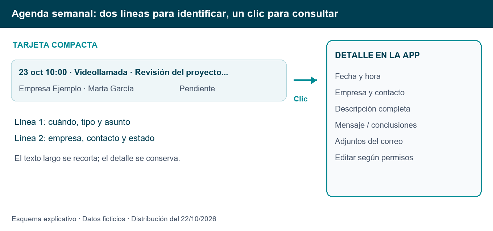

| Línea | Información visible | Para qué sirve |
| --- | --- | --- |
| Primera | Fecha, hora cuando está informada, icono, tipo y asunto. | Reconocer cuándo ocurre y de qué trata. |
| Segunda | Empresa, contacto y estado; en correos, también tipología cuando está disponible. | Identificar a quién corresponde y si queda algo por hacer. |

Los textos largos se recortan con puntos suspensivos para evitar que la tarjeta aumente de altura. Al pasar el cursor se muestra el asunto y contexto completos. Los colores siguen distinguiendo los tipos y las actividades pendientes de conclusiones.

### Procedimiento: abrir un evento o un correo desde la agenda

1. Abre **Panel de Control Comercial** y localiza **Agenda Semanal CRM**.
2. Utiliza los controles de semana para localizar el período adecuado.
3. Pulsa cualquier zona de la tarjeta; con teclado, sitúa el foco en ella y pulsa Enter o espacio.
4. Se abre un panel lateral dentro de la app con fecha, empresa, contacto y descripción completa. En correos muestra el contenido registrado y los nombres de adjuntos disponibles; en eventos, también ubicación, mensaje de invitados y conclusiones cuando existen.
5. Si tienes permiso, utiliza **Editar / Añadir conclusiones** o **Editar datos del correo**. El editor conserva el flujo habitual y sus validaciones.
6. Cierra el panel con la X, Escape o pulsando fuera para volver a la semana que estabas consultando.

Abrir esta ficha permite consultar el registro del CRM: no lanza Outlook ni descarga adjuntos. Las acciones habituales para abrir el original en Classic o Web siguen disponibles en la ficha del contacto. En los correos no se solicita completar una reunión ni registrar conclusiones pendientes; su dirección se muestra como recibido o enviado cuando está informada.

La agenda semanal del panel comercial y la ventana inicial de resumen de jornada son elementos distintos. Los correos históricos se excluyen del resumen inicial y sus pendientes de cierre; eso no implica eliminar sus registros de otras consultas.

### Al comenzar la jornada

1. Revisa los Eventos pendientes y sus fechas.
2. Antes de llamar, lee el Timeline del contacto.
3. Prioriza citas vencidas y registros sin conclusiones.
4. Confirma que estás conectado a Microsoft 365 si vas a utilizar calendario o correo integrado.

### Después de cada interacción

1. Registra llamada, visita, tarea o nota con un concepto concreto.
2. Escribe qué se ha acordado, quién lo hará y cuándo.
3. Marca realizado cuando corresponda y revisa que no falten conclusiones.
4. Guarda los correos relevantes desde Outlook y vincúlalos a la oferta correcta cuando proceda.
5. Actualiza el seguimiento de la oferta en el flujo que tengas habilitado.

### Al terminar la semana

1. Prepara el Informe Histórico de Eventos del período.
2. Revisa actividades sin conclusiones y siguientes pasos sin fecha.
3. Consulta la matriz de Clientes con el mismo corte temporal que en la revisión anterior.
4. Revisa nuevas cuentas, inactivos y cuentas sin clasificar.
5. Comparte solo el informe del ámbito autorizado y conserva el contexto de filtros y fechas.

**Ejemplo didáctico completo:** buscas una empresa inactiva, localizas al responsable, lees su histórico, llamas, registras el resultado, planificas una visita y guardas el email de confirmación. El valor del CRM está en que el siguiente compañero puede entender esa secuencia sin preguntarte de nuevo.

## 32. Incidencias: resolver lo habitual paso a paso

| Qué ocurre | Qué comprobar primero | Siguiente acción |
| --- | --- | --- |
| No encuentro una empresa o persona. | Vista correcta, búsqueda, filtros y cartera. | Confirma alta/importación y asignación comercial con el responsable. |
| Faltan tarjetas o correos. | Oferta, tipología y estado seleccionados. | Restablece filtros y comprueba empresa y contacto usados al registrar. |
| No se abre Classic. | Instalación, vinculación, cuenta y permiso de rol. | Prueba el destino Web explícito y comunica el aviso exacto. |
| Windows pide una app para dts-outlook. | Componente instalado con el usuario Windows actual. | Extrae el ZIP publicado y ejecuta su instalador; después revisa la vinculación. |
| Windows pide una app para dts-mail. | Puede quedar una versión antigua de la app en caché. | Recarga la app actual y utiliza el componente nuevo. No reinstales el manejador retirado. |
| Hay varias copias del correo. | Carpeta y fecha del selector. | Elige la copia correcta; no basta comparar asuntos parecidos. |
| No llega confirmación de apertura. | Comprueba si el correo ya está visible en Classic. | Evita repetir clics y utiliza Web si lo necesitas. |
| No hay nombres de adjuntos. | Puede ser un registro antiguo o una captura incompleta. | Consulta el original en Outlook; no deduzcas que no tiene archivos. |
| Un envío está sin confirmar. | Elementos enviados y bandeja de salida. | No reenvíes a ciegas; espera la conciliación o consulta soporte. |
| Evento a distinta hora. | Fecha, zona horaria y calendario consultado. | Compara ambos registros e indica la diferencia exacta a soporte. |
| No sale un PDF de informe. | Datos, período y permiso de ventana de impresión. | Abre la vista previa y elige Guardar como PDF. |

Al comunicar una incidencia, indica vista, acción, hora, cuenta usada, Classic o Web y mensaje visible. Incluye código de cliente u oferta si procede. Nunca envíes contraseñas, códigos de vinculación activos ni tokens.

### Si una invitación no llega o Gmail ofrece traducirla

1. Comprueba que el tipo es **Visita a Cliente** o **Videollamada**, no **Visita no programada**.
2. Revisa la casilla de envío, los destinatarios, la fecha, la hora y la conexión de calendario.
3. Comprueba Outlook y las carpetas de correo del destinatario antes de repetir el alta.
4. Si Gmail identifica inglés aunque el texto esté en español, distingue el idioma del texto del idioma declarado por el mensaje. En una invitación real se detectó la marca inglesa tanto en el correo como en el calendario.
5. La corrección preparada el 22/10 declara español en las convocatorias y su HTML. Se debe desplegar y comprobar una invitación nueva en Gmail. Los mensajes ya enviados conservan sus marcas originales.

## 33. Glosario y comprobación de aprendizaje

| Término | Significado práctico |
| --- | --- |
| ERP / Business Central | Sistema donde se formalizan los datos maestros y las ofertas importadas. |
| Cartera | Conjunto de clientes asignados a un comercial. |
| YTD | Acumulado desde el inicio del año hasta un corte comparable. |
| YoY | Comparación con el año anterior. |
| KPI | Indicador que resume una medida; hay que leer su ámbito y período. |
| Timeline | Historial de interacciones ordenado por fecha y hora. |
| Kanban | Tablero con columnas de fases y tarjetas. |
| Ponderado | Importe ajustado a la probabilidad; es previsión, no facturación. |
| Borrador | Mensaje preparado que todavía no debe darse por enviado. |
| Vincular equipo | Autorizar el componente de ese usuario Windows para las solicitudes de Classic. |
| Vincular prospecto | Asociar el historial de prospección con una empresa ya formalizada. |

### Comprueba que ya puedes trabajar

- Puedo distinguir un cliente de un contacto y una actividad de una oferta.
- Sé buscar, filtrar y restablecer el directorio sin crear duplicados.
- Puedo explicar qué significa una categoría A-F.
- Sé elegir un período comparable antes de exportar una matriz.
- Puedo crear una actividad, registrar conclusiones y verificar su estado.
- Sé registrar un correo en el contacto y oferta adecuados.
- Sé que Responder prepara una respuesta y no la envía por sí solo.
- Sé que los nombres de adjuntos no son enlaces de descarga.
- Sé que eliminar un email del CRM conserva el original en Outlook.

**Siguiente nivel:** utiliza las rutinas del capítulo 31 durante una semana y revisa el informe con tu responsable. La finalidad es que cualquier seguimiento termine con un siguiente paso claro.

## 34. Alcance, versión y referencias para mantenimiento

Este manual se ha contrastado con el código del proyecto y con consultas de las vistas reales de producción el 19/10/2026. Se han abierto pantallas y formularios para documentarlos, sin guardar altas, enviar mensajes ni realizar cambios de clasificación durante la captura.

**Capturas reales:** Directorio de Clientes, Matriz de Relación, Directorio de Contactos, Informe Histórico, Información, Timeline, Eventos, formulario de Nueva Actividad, Emails, menú de Outlook y formulario de redacción. Contienen información interna y deben distribuirse dentro de la empresa. Los diagramas se han creado específicamente como ayudas de formación.

**Disponibilidad:** la ficha lateral de cliente y Prospección dependen de acceso habilitado. La pestaña Ofertas conserva la convivencia entre el seguimiento anterior y el nuevo. Las instrucciones explican cómo reconocerlos; no se afirma que todas las cuentas utilicen ya el mismo flujo.

### Revisión 1.1 - 22/10/2026

Esta edición incorpora la búsqueda sin tildes en Contactos, el alcance de cartera acordado para cada rol, las invitaciones de visitas y videollamadas, el mensaje público en la primera columna al crear, las conclusiones a todo el ancho, la ubicación fija sala Teams y la agenda semanal de dos líneas con apertura del detalle.

**Confirmado por el usuario:** recepción de invitación de visita; apertura de correo Classic/Web y tras moverlo de carpeta; prueba sin borradores; vinculaciones; permisos por rol de Outlook; avisos flotantes; contadores por oferta; adjuntos tras editar; correo preparado desde CRM; segundo usuario; adjuntos desde Classic/Web, enviados/recibidos, más de tres adjuntos y exclusión de firma; borrado del correo únicamente del CRM. El usuario valoró favorablemente la agenda compacta y solicitó incorporarla al manual.

**Validado automáticamente y sincronizado en la carpeta local:** búsqueda sin tildes, cambios de formulario, ubicación de videollamada, marca de español y agenda compacta. No se presume su despliegue en producción. Quedan pendientes la recepción de una convocatoria nueva en Gmail con las marcas corregidas, la ubicación sala Teams en una nueva convocatoria real y la comprobación completa de Tester/Producción en la interfaz de Clientes y Contactos. Los escenarios con varios invitados y sus cambios no quedan certificados por la prueba de recepción de una sola visita.

Las capturas reales siguen fechadas el 19/10/2026. Los dos nuevos esquemas son ayudas explicativas, no capturas nuevas de producción. El manual contiene 34 capítulos; esta revisión amplía los procedimientos existentes.

### Referencias internas

- [Guía funcional y técnica de CRM Clientes](../../vistas/03_crm/crm_clientes.md).
- [Guía de CRM Contactos y Emails](../../vistas/03_crm/crm_contactos_mails.md).
- [Guía del complemento de Outlook](../../vistas/03_crm/complemento_outlook_crm.md).
- [Ajustes Generales](../../vistas/06_administracion_configuracion/ajustes_generales.md).
- [Manual de instalación de Outlook](../../manual-instalacion-addin-outlook.md).
- [Manual general de usuario](../../manual-usuario.md).

**Revisión recomendada:** actualizar esta guía cuando cambien nombres de botones, permisos, clasificación, campos de actividad, flujo de ofertas o configuración de Outlook. Conservar juntas la versión Markdown y su carpeta de imágenes; el PDF incorpora las imágenes y puede leerse por separado.
